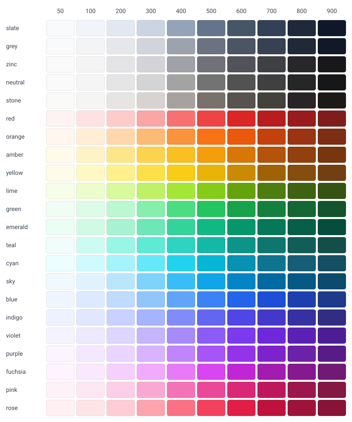
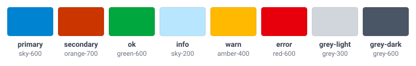

# Sassy

A Sass utility framework built from [placeholder selectors](https://sass-lang.com/documentation/style-rules/placeholder-selectors/) (`%`) instead of classes. Inspired by [Bootstrap](https://getbootstrap.com) and [Tailwind CSS](https://tailwindcss.com), it aims for the best of both: you only load the styles you use, and you don't need `npm`.

You `@extend` the utilities you want onto your own selectors, so your markup stays semantic and your compiled CSS contains only the rules you actually use. If you would rather use classes in your HTML, a full build with every utility as a class is also available.

```sass
@use "sassy/src/base" as sassy

.card
    @extend %bf-p-3
    @extend %bf-p-5-md
    @extend %bf-rounded
    @extend %bf-shadow-1

.card-title
    @extend %bf-c-primary
    @extend %bf-font-weight-700
```

compiles to (alongside Normalize, Sassy's custom properties and the [wrap](#wrap) classes):

```css
.card-title {
  font-weight: 700;
}
.card {
  padding: 0.75rem;
}
.card {
  border-radius: var(--sassy-radius);
}
.card {
  box-shadow: 0 0.125rem 0.25rem color-mix(in oklab, var(--sassy-shadow-colour) 7.5%, transparent);
}
.card-title {
  color: var(--sassy-theme-primary);
}
@media (min-width: 768px) {
  .card {
    padding: 1.25rem;
  }
}
```

## Getting started

### Sass

Sassy needs [Dart Sass](https://sass-lang.com/dart-sass/) 1.79.0 or later, the first version that understands `oklch()` colours. Add it to your project, for example as a git submodule:

```sh
git submodule add https://github.com/bfren/sassy.git sassy
```

then load it once, in your site's main stylesheet:

```sass
@use "sassy/src/base" as sassy
```

Use a single entry stylesheet per site: each stylesheet that loads Sassy also outputs Normalize and Sassy's `:root` custom properties.

### Classes

`dist/full.css` contains every utility as a class (`.bf-p-3`, `.bf-col-4-md` and so on), for use straight from HTML:

```html
<link rel="stylesheet" href="https://cdn.jsdelivr.net/gh/bfren/sassy@0.3.0/dist/full.min.css" />
```

It is large - around 1.9 MB, or 180 KB gzipped - because it contains everything. If you are using Sass, extending placeholders will give you much smaller CSS.

## Naming

Every placeholder follows the same pattern:

```
%bf-{utility}-{value}-{breakpoint}
```

The breakpoint is optional - see [Responsive](#responsive). Names use British spelling: `centre`, `colour`, `capitalise`, `grey`.

| Module             | Examples                                                                                                                                                                                    |
| ------------------ | ------------------------------------------------------------------------------------------------------------------------------------------------------------------------------------------- |
| Layout             | `%bf-p-2`, `%bf-mt-3`, `%bf-mx-auto`, `%bf-m-centre`, `%bf-width-50`, `%bf-viewheight-100`, `%bf-max-width-100`, `%bf-position-sticky`, `%bf-top-0`, `%bf-z-index-3`, `%bf-overflow-hidden` |
| Display and flex   | `%bf-d-flex`, `%bf-d-none`, `%bf-flex-justify-between`, `%bf-flex-align-items-centre`, `%bf-flex-wrap-nowrap`, `%bf-flex-order-last`, `%bf-gap-3`, `%bf-opacity-50`, `%bf-visually-hidden`  |
| Colour             | `%bf-c-red-500`, `%bf-bg-sky-100`, `%bf-border-grey-300`                                                                                                                                    |
| Theme              | `%bf-c-primary`, `%bf-bg-error`, `%bf-border-ok`, `%bf-shadow-primary-2`                                                                                                                    |
| Text               | `%bf-body`, `%bf-font-size-4`, `%bf-font-family-mono`, `%bf-font-weight-700`, `%bf-line-height-single`, `%bf-text-align-centre`, `%bf-text-transform-upper`                                 |
| Border and corners | `%bf-border-1`, `%bf-border-x-2`, `%bf-rounded`, `%bf-rounded-3`, `%bf-rounded-pill`                                                                                                        |
| Shadow             | `%bf-shadow-2`, `%bf-shadow-sky-700-2`                                                                                                                                                      |
| Grid               | `%bf-d-flex-row`, `%bf-col-6`                                                                                                                                                               |
| Forms              | `%bf-form-control`, `%bf-form-select-small`, `%bf-form-check-input`, `%bf-form-switch`, `%bf-form-feedback-invalid`                                                                         |

A few conventions:

- **Sides** are `t`, `e`, `b` and `s` (top, end, bottom, start), so `%bf-mt-3` is `margin-top` and `%bf-ps-2` is `padding-left`. `x` is both horizontal sides and `y` both vertical sides.
- **Spacing** (margin, padding and gap) runs from 0 to 20 in steps of 0.25rem: `%bf-p-4` is `1rem`.
- **Sizes** run from 5 to 100 in steps of 5: `%bf-width-50` is `50%`, `%bf-viewheight-100` is `100vh`.
- **Colours** are the [Tailwind CSS v4](https://tailwindcss.com/docs/colors) palette - the neutrals `slate`, `grey`, `zinc`, `neutral`, `stone`, `mauve`, `olive`, `mist` and `taupe`, and `red`, `orange`, `amber`, `yellow`, `lime`, `green`, `emerald`, `teal`, `cyan`, `sky`, `blue`, `indigo`, `violet`, `purple`, `fuchsia`, `pink` and `rose` - each with shades `50`, then `100` to `900`, and `950`. They are defined in `oklch()`, so on wide-gamut screens the most vivid shades show more vividly than sRGB allows.

  

  The `oklch()` value of every shade is in [`src/base/_21-colour-variables.scss`](src/base/_21-colour-variables.scss).

- **Theme colours** are `primary`, `secondary`, `ok`, `info`, `warn`, `error`, `grey-light` and `grey-dark`, and can be changed at runtime - see [Theming](#theming). The defaults are:

  

- **Grid** columns are out of 12: extend `%bf-d-flex-row` on the container and `%bf-col-{1-12}` on each column.

## Responsive

Most utilities have a variant for each breakpoint, which applies from that width upwards:

| Breakpoint | Applies from |
| ---------- | ------------ |
| `sm`       | 576px        |
| `md`       | 768px        |
| `lg`       | 992px        |
| `xl`       | 1200px       |
| `2xl`      | 1400px       |
| `3xl`      | 1600px       |

```sass
.sidebar
    @extend %bf-d-none
    @extend %bf-d-block-lg
    @extend %bf-col-12
    @extend %bf-col-4-lg
```

Sass cannot `@extend` inside a media query, which is why breakpoints are part of the name rather than written with `@media`.

Sassy guarantees the order of its output, so combinations behave as you would expect whatever order you extend them in:

- a breakpoint variant always overrides the base utility and any smaller breakpoint - `%bf-d-none` + `%bf-d-block-lg` is hidden until `lg`
- single-purpose utilities always override composite ones - `%bf-col-4` + `%bf-p-0` removes the column's gutter, and `%bf-form-control` + `%bf-mb-3` adds a margin to the control

Form placeholders, `%bf-visually-hidden` and `%bf-body` have no breakpoint variants.

### Wrap

`.wrap` and `.wrap-fluid` are output as classes as well as placeholders. `.wrap` is a centred container whose width steps up at each breakpoint, and `.wrap-fluid` is always full width.

## Configuration

### Sass settings

Settings are passed with `with (...)` when you load Sassy:

```sass
@use "sassy/src/base" as sassy with (
    $sassy-breakpoints: (sm: 600px, md: 900px, lg: 1200px),
    $sassy-padding-unit: 0.5rem
)
```

| Setting                                                        | Default                 | Description                                                                    |
| -------------------------------------------------------------- | ----------------------- | ------------------------------------------------------------------------------ |
| `$sassy-breakpoints`                                           | `sm` to `3xl`, as above | Names and minimum widths - every responsive variant is generated from this map |
| `$sassy-margin-unit`, `$sassy-padding-unit`, `$sassy-gap-unit` | `0.25rem`               | Size of one spacing step                                                       |
| `$sassy-radius-unit`                                           | `0.25rem`               | Size of one step for `%bf-rounded-{0-6}`                                       |
| `$sassy-shadow-unit`                                           | `0.125rem`              | Size of one step for `%bf-shadow-{0-3}`                                        |
| `$sassy-loop-max`                                              | `20`                    | Highest spacing, border width and flex grow / shrink step                      |
| `$sassy-prefix`                                                | `"bf"`                  | Prefix for every placeholder (and class) - `""` for none                       |
| `$sassy-separator`                                             | `"-"`                   | Joins the prefix, utility, value and breakpoint                                |
| `$sassy-full`                                                  | `false`                 | Also output every utility as a class, as in `dist/full.css`                    |

The prefix keeps Sassy's placeholders apart from your own and from other libraries: placeholders with the same name are merged, so an unprefixed `%p-2` of your own would pick up Sassy's rules too. It costs nothing in your compiled CSS.

### Theming

Colours, fonts, the radius, the grid gutter and form styles are CSS custom properties on `:root`, so you can change them per site, per section or at runtime - for example in dark mode:

```sass
:root
    --sassy-theme-primary: #{sassy.colour("teal", 600)}

@media (prefers-color-scheme: dark)
    :root
        --sassy-body-colour: #{sassy.colour("grey", 100)}
        --sassy-input-bg: #{sassy.colour("grey", 800)}
        --sassy-input-colour: #{sassy.colour("grey", 100)}
        --sassy-input-border-colour: #{sassy.colour("grey", 600)}
        --sassy-select-chevron: #{sassy.chevron(sassy.colour("grey", 100))}
```

Colour properties accept **any CSS colour** - hex, `rgb()`, `oklch()`, a named colour or another custom property - and Sassy adds transparency where it needs it with `color-mix()`. Use `sassy.colour(name, shade)` to get any palette colour, or write a value directly: `--sassy-theme-primary: #0d9488`.

The one exception is the select chevron, an SVG image that cannot read custom properties. If you change `--sassy-input-colour`, set `--sassy-select-chevron` to match using `sassy.chevron()`, as in the example above.

The main groups are:

| Prefix                                                                                                              | Controls                                                                                        |
| ------------------------------------------------------------------------------------------------------------------- | ----------------------------------------------------------------------------------------------- |
| `--sassy-theme-*`                                                                                                   | Theme colours: `primary`, `secondary`, `ok`, `info`, `warn`, `error`, `grey-light`, `grey-dark` |
| `--sassy-body-*`, `--sassy-font-*`, `--sassy-line-height-base`                                                      | Text defaults used by `%bf-body` and the font utilities                                         |
| `--sassy-radius`, `--sassy-shadow-colour`, `--sassy-grid-gutter`                                                    | Default corner radius, shadow colour and column gutter                                          |
| `--sassy-input-*`, `--sassy-check-*`, `--sassy-switch-*`, `--sassy-floating-*`, `--sassy-range-*`, `--sassy-form-*` | Form controls - sizes, colours, focus ring and validation states                                |

## Forms

Form placeholders style controls in the same way as Bootstrap's form classes, and follow the same naming:

| Placeholder                                                   | For                                          |
| ------------------------------------------------------------- | -------------------------------------------- |
| `%bf-form-label`, `%bf-form-text`                             | Labels, and help text under a control        |
| `%bf-form-control`, `-small`, `-large`, `-plaintext`          | Text inputs and textareas                    |
| `%bf-form-select`, `-small`, `-large`                         | Selects                                      |
| `%bf-form-check`, `%bf-form-check-inline`                     | A checkbox or radio with its label           |
| `%bf-form-check-input`, `%bf-form-check-label`                | The checkbox or radio, and its label         |
| `%bf-form-switch`                                             | A checkbox shown as a switch                 |
| `%bf-input-group`, `-small`, `-large`, `%bf-input-group-text` | Controls and add-on text joined side by side |
| `%bf-form-floating`                                           | A control with its label floating inside it  |
| `%bf-form-range`                                              | Range sliders                                |
| `%bf-form-file`                                               | File inputs                                  |
| `%bf-form-colour`                                             | Colour pickers                               |
| `%bf-form-control-valid`, `%bf-form-control-invalid`          | A validation state set explicitly            |
| `%bf-form-feedback-valid`, `%bf-form-feedback-invalid`        | Validation messages                          |

Sizes combine with the base placeholder: extend both `%bf-form-control` and `%bf-form-control-small`. Sizes are `small` and `large` rather than `sm` and `lg`, which are breakpoints. A size only changes custom properties, so it works on any control - and on an input group, where everything inside follows it.

```sass
.field
    @extend %bf-mb-3

    label
        @extend %bf-form-label

    input, textarea
        @extend %bf-form-control

    .error
        @extend %bf-form-feedback-invalid
```

```html
<div class="field">
    <label for="email">Email</label>
    <input type="email" id="email" required />
    <span class="error">Please enter a valid email address.</span>
</div>
```

The markup matters in a few places:

- **Validation** shows when a control is invalid in either of two ways: the browser's own `:user-invalid`, which only applies once someone has interacted with the field, or `aria-invalid="true"`, which you set for errors found on the server. Use `aria-invalid` for server errors, because screen readers announce it too.
- **Feedback comes after the control**, as a sibling: invalid feedback stays hidden until the control before it is invalid, so you can render the message up front and the browser reveals it. Valid feedback always shows, so only render it when the field is valid.
- **Checks and radios** put the input first, then the label, then any help text or feedback, inside the element extending `%bf-form-check`. Long labels wrap beside the input, and help text lines up under the label.
- **Switches** are checkboxes with `role="switch"`, so assistive technology announces them as switches.
- **Input groups** contain the controls and add-ons directly. Put feedback after the group, not inside it: it shows when any control in the group is invalid.
- **Floating labels** put the control first and the label after it, and the control needs `placeholder=" "` - an empty placeholder is how CSS tells that the control has no value.

Sizes, colours, the focus ring and the validation colours all come from the `--sassy-input-*`, `--sassy-check-*`, `--sassy-switch-*`, `--sassy-floating-*`, `--sassy-range-*` and `--sassy-form-*` custom properties - see [Theming](#theming).

## Limitations

- **No `@extend` inside media queries.** Sass does not allow it, which is why every responsive utility has a breakpoint variant in its name (see [Responsive](#responsive)).
- **Every file that extends needs its own `@use`.** `@extend` only reaches placeholders in modules the file itself loads, so a partial that extends Sassy's placeholders must `@use` Sassy too. Sass only outputs a module once per compilation, so this does not duplicate anything.
- **One entry stylesheet per site.** Each separately compiled stylesheet that loads Sassy includes Normalize and the `:root` custom properties again.
- **Placeholders cannot be used from HTML.** If you need classes in your markup, use `dist/full.css` or set `$sassy-full: true`.
- **Current browsers only.** Sassy relies on features that have been [Baseline](https://web.dev/baseline) since 2023 or earlier, including `:user-invalid`, `:focus-visible`, `:is()`, CSS masks, `inset`, `gap`, `:has()`, `oklch()` and `color-mix()`.

## Editor snippets

`dist/sassy.code-snippets` is a [VS Code snippets file](https://code.visualstudio.com/docs/editing/userdefinedsnippets) listing every placeholder, so typing a name in a Sass file offers matching placeholders, each with the CSS it applies.

To use it in one project, copy it into that project's `.vscode` folder. To use it everywhere, copy it into your VS Code user snippets folder - run **Snippets: Configure Snippets** from the Command Palette to find it.

Then start typing a placeholder name after `@extend %` - for example `bf-p` - and pick from the list.

The file is generated from `dist/full.css` by `snippets.sh`, which `compile-full.sh` runs after each build. If you change `$sassy-prefix`, compile a full build with your prefix and generate snippets from it: `SASSY_PREFIX=<prefix> ./snippets.sh <your-full.css> <output.code-snippets>`.

## Building and contributing

You need [Dart Sass](https://sass-lang.com/dart-sass/) 1.79.0 or later on your path, and bash with `gzip` and `awk` - these come with macOS and Linux, and with [Git for Windows](https://gitforwindows.org) on Windows.

| Script                  | Does                                                                                                         |
| ----------------------- | ------------------------------------------------------------------------------------------------------------ |
| `compile-full.sh`       | Builds `dist/full.css` and `dist/full.css.gz`, then runs `snippets.sh` and `palette.sh`                      |
| `compile-full.bat`      | Runs `compile-full.sh` in Git Bash on Windows                                                                |
| `watch.sh`, `watch.bat` | Recompiles the test stylesheets in `test/sass` whenever they change - open the pages in `test` to check them |
| `snippets.sh`           | Generates `dist/sassy.code-snippets` from `dist/full.css`                                                    |
| `palette.sh`            | Generates the colour charts in `docs` from the colour and theme variables                                    |

### Structure

The modules in `src/base` are numbered so related modules sit together, with gaps for new ones:

| Numbers   | Contain                                                              |
| --------- | -------------------------------------------------------------------- |
| `00`-`01` | Copyright notice and Normalize                                       |
| `10`-`12` | Settings, the `make` mixins that generate placeholders, and helpers  |
| `20`-`31` | Utilities: layout, colour, display, text, border, corners and shadow |
| `40`-`41` | Theme colours and the grid                                           |
| `50`-`59` | Forms - `50` holds mixins shared by the form modules                 |
| `99`      | Render - outputs every module in the right order                     |

Each module's settings and custom properties live in a matching `-variables.scss` file, forwarded from `_10-variables.scss`.

### Adding a module

1. Create `_NN-name.sass` with a `utilities` mixin that generates its placeholders using `make.single` (no breakpoint variants) or `make.responsive`.
2. Put any settings in `_NN-name-variables.scss`, with `!default`, and forward it from `_10-variables.scss`.
3. Forward the module from `_index.sass` with `hide utilities`.
4. `@use` the module in `_99-render.sass` and include its `utilities` mixin - before the single-purpose utilities if its placeholders set several properties at once, so that utilities can override them.

Never hard-code the `bf` prefix - use `make.name()` to build a placeholder name from `$sassy-prefix`.

Pull requests are welcome. Commits to this repository must be signed.

## Licence and credits

Sassy is released under the [MIT licence](https://mit.bfren.dev/2022).

It includes:

- [Normalize.css](https://github.com/csstools/normalize.css), licensed under [Creative Commons Zero v1.0 Universal](https://creativecommons.org/publicdomain/zero/1.0/)
- the colour palette from [Tailwind CSS v4.3.3](https://github.com/tailwindlabs/tailwindcss/blob/v4.3.3/packages/tailwindcss/theme.css), licensed under [MIT](https://github.com/tailwindlabs/tailwindcss/blob/v4.3.3/LICENSE)
